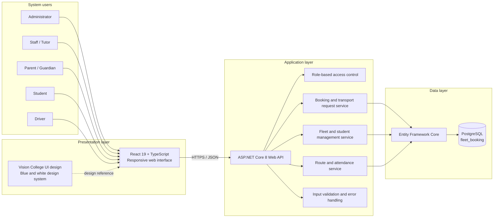

# Vision College Fleet Booking and Tracking System

## System architecture

## Component responsibilities

| Component | Responsibility |
|---|---|
| React frontend | Displays responsive dashboards, forms, tables, route screens, attendance controls, and privacy-limited family views. |
| ASP.NET Core Web API | Exposes HTTP endpoints and applies application rules for bookings, fleet records, routes, attendance, and change requests. |
| Role-based access control | Separates administrator/staff management permissions from parent, student, and driver permissions. |
| Booking service | Creates and retrieves transport requests and links selected students to a request. |
| Fleet service | Manages vans, students, addresses, users, and parent address-change requests. |
| Journey service | Retrieves routes and updates passenger attendance for assigned journeys. |
| Entity Framework Core | Maps C# domain entities to PostgreSQL tables and manages relational queries. |
| PostgreSQL | Stores persistent users, student profiles, addresses, bookings, routes, stops, events, and attendance. |

## Main data flow

1. A staff member or administrator creates a transport request in React.
2. React sends the request as JSON to the ASP.NET Core API.
3. The API validates the requester, journey details, and selected students.
4. Entity Framework Core persists the request and relationships in PostgreSQL.
5. An administrator can generate/review a route and assign a van and driver.
6. The driver updates stop progress and attendance through the driver portal.
7. Parent and student portals show only the permitted journey and attendance information.
8. A parent address change is stored as a pending request until staff or an administrator approves it.

## Security and privacy boundaries

- Passwords and real database credentials must not be stored in the frontend or committed to source control.
- Student addresses and guardian information are restricted to authorised staff, administrators, and the assigned driver.
- Parent requests cannot directly modify the official student address.
- Approval is required before a proposed parent address becomes current.
- Family views must not expose other students, the complete route, or private addresses.
