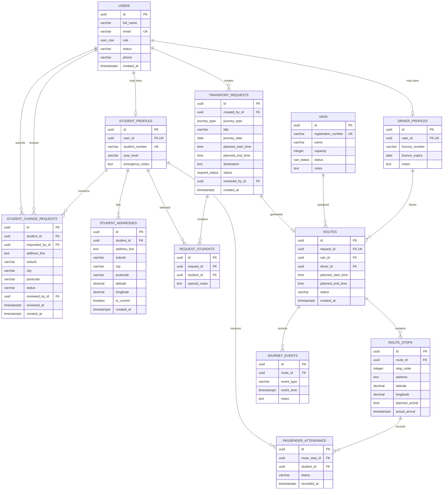

# Vision College Fleet Booking and Tracking System

## Entity relationship diagram

## Relationship summary

| Relationship | Meaning |
|---|---|
| `users` to `student_profiles` | A student profile is linked to one user account. |
| `users` to `driver_profiles` | A driver profile is linked to one user account. |
| `users` to `transport_requests` | A staff member or other authorised user can create requests. |
| `transport_requests` to `request_students` | A request can contain multiple students. |
| `student_profiles` to `student_addresses` | A student can have address history, with one current address. |
| `transport_requests` to `routes` | An approved request can have one generated route. |
| `routes` to `route_stops` | A route contains ordered pickup and destination stops. |
| `route_stops` to `passenger_attendance` | Attendance is recorded for a student at a stop. |
| `student_profiles` to `student_change_requests` | Parents can propose address changes for a student. |
| `student_change_requests` to `users` | Staff or administrators review and approve/decline requests. |
